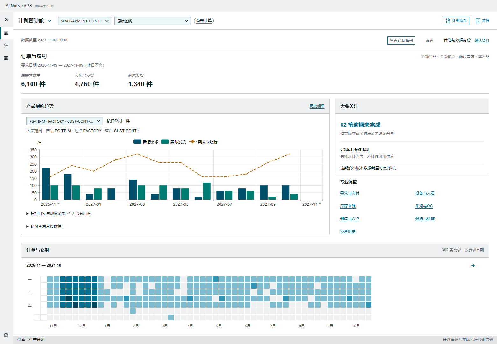

# AI Native APS

制造计划与排程工作台。导入订单、库存、采购、工艺、设备和人员资料，在同一数据版本上运行约束计划，从交期异常追溯到供给和工序，再比较调整对各订单的影响。

**技术栈**　Python · FastAPI · React · TypeScript · frePPLe Community · OR-Tools

**许可证**　[MIT](LICENSE)，Odoo 插件使用 LGPL-3.0。



*年度模拟企业的工作台实拍。经营数据来源于已确认的业务版本，计划结果通过右上角入口查看。*

## 功能

| 模块 | 用途 |
| --- | --- |
| 数据接入 | 导入 Excel 和结构化业务数据，核对字段映射、来源和未知状态，保存可追溯的数据版本。 |
| 联合规划 | 将物料、设备容量、人员资格、批量、换线、采购质检和已有工单保护交给 frePPLe Worker 计算。 |
| 调查与排程 | 浏览订单、采购、库存、工序和资源，在甘特图和业务报表中定位相关记录。 |
| 方案调整 | 创建独立草案，试算交期、优先级、采购延期、设备停机等条件，比较受益和受损的订单。 |
| 候选优化 | 使用 CP-SAT 和邻域搜索生成有边界的调整候选，由原生规划结果确定实际采用与业务影响。 |
| Agent 与 ERP | 通过 MCP 进行有范围的调查和建议，在具备权限的部署中交接计划并回读外部状态。 |

## 快速开始

本地工作台需要 **Python 3.12** 和 **Node.js ≥ 22.19**。以下命令适用于 Windows PowerShell。

```powershell
git clone https://github.com/mumuyang068/ai-native-aps.git
cd ai-native-aps

python -m venv .venv
.\.venv\Scripts\python -m pip install -r requirements.txt

Push-Location frontend
npm ci
npm run build
Pop-Location

.\.venv\Scripts\python -m scripts.local_workspace --make-example
.\.venv\Scripts\python -m scripts.local_workspace
```

打开 **http://127.0.0.1:8765/workspace/**，进入企业资料，上传生成的 `.aps-local/demo-garment.xlsx`。勾选核对事项、填写核对人并保存版本后，可以查看订单、库存等来源事实。示例工作簿由仓库中的合成成衣数据生成。运行状态保存在项目目录的 `.aps-local/`，按 `Ctrl+C` 停止本地服务。

默认启动模式支持资料核对和事实查询。运行原生计划时，按 [Worker 接入说明](docs/worker.md) 连接独立配置的规划服务。年度驾驶舱、下列甘特和比较截图分别使用已有验收案例的数据。

## 运行示例

| 页面 | 查看内容 |
| --- | --- |
| [逾期订单明细](docs/showcase/overdue-orders.png) | 从年度驾驶舱的逾期数量进入订单清单，核对已发货、剩余量和要求日期。 |
| [制造甘特与工单保护](docs/showcase/native-schedule.jpg) | 查看设备排程及原工单的保护窗口。 |
| [基线与候选比较](docs/showcase/scenario-comparison.jpg) | 在同版资料下比较两个原生计划，追踪订单间供给变化。 |

完整服装厂模拟案例使用 **28 类、419 条业务事实**，24 条确认需求共 **480 件**。原生结果安排了 **360 件**，保留 **120 件**未排缺口。提高一条订单行的优先级后，该行多获 20 件，另一行少获 20 件，总计划满足量保持不变。逐单对照可以看出这次加急的业务代价。

## 架构与源码

[查看逻辑架构图](docs/showcase/architecture.png)

企业资料经过校验后形成固定数据版本。基线与调整草案各自保留输入和运行身份。Worker 返回计划结果，工作台据此读取交付、材料和资源信息。Agent 使用同一套业务接口，受保护操作由有权限的人员确认。

| 路径 | 职责 |
| --- | --- |
| `frontend/` | React 工作台、甘特、ECharts 图表及业务报表。 |
| `p2/`、`p21/`、`p22/` | 导入、核对、业务版本、计划及分析入口。 |
| `planning_adapter.py`、`planning_api.py`、`run_store.py` | 原生输入适配、Worker API 与运行存储。 |
| `plan_editor.py`、`optimization/` | 计划编辑和候选搜索。 |
| `p3_mcp_tools.py`、`interop/`、`integrations/odoo/` | 专业 MCP 工具及 ERP 交接与回读。 |
| `fixtures/`、`tests/` | 合成样本、归档的合成回归夹具及可在本地运行的检查。 |

## 验证

```powershell
.\.venv\Scripts\python -m pip install -r requirements-test.txt
.\.venv\Scripts\python -m pytest

Push-Location frontend
npm test -- --run
Pop-Location
```

本项目面向研究和本地验证。生产环境的接入、鉴权及部署需按实际企业环境配置。APS 主体使用 [MIT 许可证](LICENSE)。Odoo 插件与外部依赖的许可见 [第三方说明](THIRD_PARTY_NOTICES.md)。
