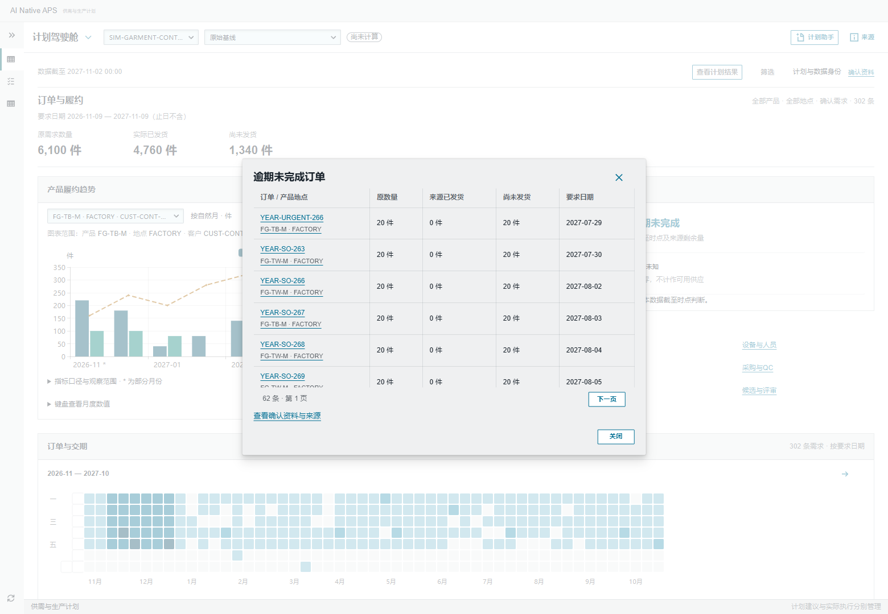
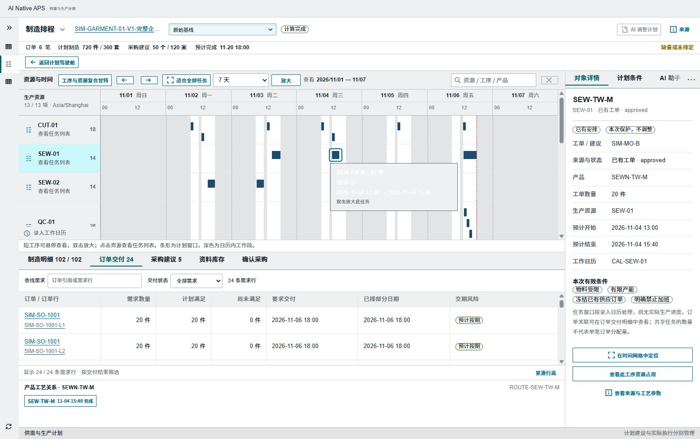
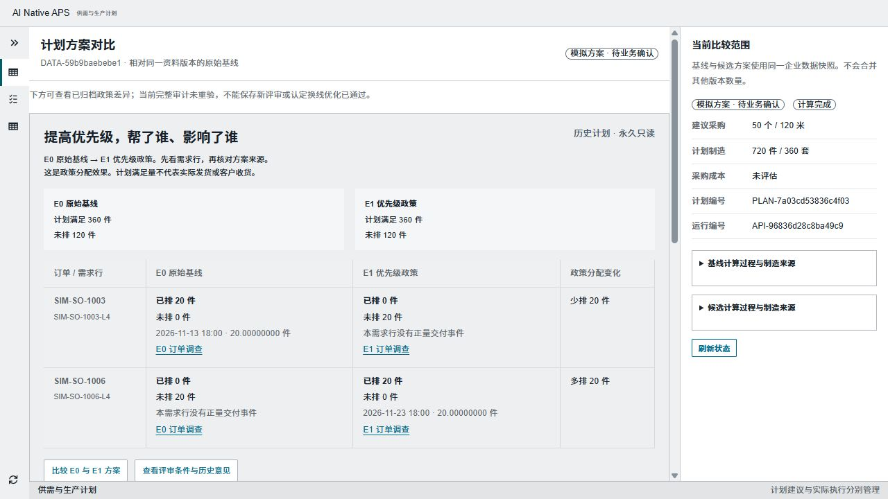

# AI Native APS｜制造计划与排程工作台

面向生产计划员的高级计划与排程系统（Advanced Planning and Scheduling，APS）研究原型。它把订单、物料、采购、工艺、设备和人员约束放进同一套计划，让计划员能从交期异常追到业务来源，试算调整方案，再判断哪些订单受益、哪些订单需要重新协调。

本仓库收录项目介绍、运行截图和逻辑架构图。

**一个典型问题：客户要求加急时，工厂能腾出供给吗？** 在服装厂模拟案例中，提高一条订单行的优先级后，它多分配了 20 件，另一条订单行则少分配了 20 件。总计划满足量仍是 360 件。方案对比把这笔取舍直接呈现给计划员。


*年度经营模拟案例的本地运行截图。画面覆盖 302 条确认需求，展示原需求 6,100 件、模拟发货记录 4,760 件、尚未发货 1,340 件。经营视图可以直接读取已确认资料，顶部状态对应当前方案的计算进度。*

## 计划员可以怎样使用

| 工作 | 在页面上可以做什么 |
| --- | --- |
| 了解经营状态 | 查看需求、发货、未履行趋势和订单交期分布，按产品或日期筛选，从逾期数字下钻到具体订单。 |
| 调查交付风险 | 从订单追到已有供给、采购到货与质检放行、库存事件、制造工序、设备及具名人员占用。 |
| 核对排程 | 在甘特图查看工序、资源、日历和原工单保护窗口，选中任务后查看同一对象的详情。 |
| 试算调整 | 对允许调整的对象生成草案，例如调整采购到货、模拟设备停机或改变订单优先级，再交由原规划 Worker 计算。 |
| 比较与评审 | 用同版业务数据比较基线与候选，查看订单数量和交付时点的变化，记录讨论或暂缓意见。 |
| 交接与回读 | 在得到相应授权后交接给外部业务系统，分别查看当时的接纳回执与后续执行状态。 |



*点击「62 笔逾期未完成」即可查看清单。「尚未发货」是订单余额，「逾期未完成」还要按要求交付日和数据截至时间判断。*

## 一次完整的规划和方案比较

### 先用完整企业数据排一次

服装厂模拟案例包含 **28 类、419 条业务事实**和 **24 条确认需求，共 480 件**。规划把物料清单、固定批量、采购及质检可用时间、设备容量、具名人员资格、工作日历、换线、在制品（WIP）和已有工单保护放进同一次原生计算。frePPLe 结果中，**360 件得到计划满足，120 件未排**。计划员可以沿订单、工序和资源查看结果及其来源。



*完整企业案例的阶段验收截图。选中的工序属于已有工单，右侧显示原排程窗口和保护状态。*

### 再核对加急的代价

本次只改变目标订单行的优先级，基线和候选使用同一企业数据版本。结果经原生计算产生，两条受影响的需求行如下。

| 指标 | 原始基线 | 提高优先级后 |
| --- | ---: | ---: |
| 目标需求行 `SIM-SO-1006-L4` 计划满足 | 0 件 | 20 件 |
| 受影响需求行 `SIM-SO-1003-L4` 计划满足 | 20 件 | 0 件 |
| 总计划满足 | 360 件 | 360 件 |
| 总未排 | 120 件 | 120 件 |

订单加急改变了供给的分配。计划员据此可以继续调查被挤占的订单，并决定是否值得采用。



*只读历史方案的实拍。表中数量和交付事件来自原生计划结果。*

## 系统如何把业务事实变成可评审的计划

1. **接入与确认。** Excel、结构化记录或已验证的连接器输入经过映射和人工核对，形成带来源和时间的企业数据版本。经营页面从同一资料读取订单及实际记录，未知库存保留未知状态。
2. **准备与计算。** 计划引用固定数据版本，调整条件存为独立草案。规划 Worker 调用 frePPLe，把交付、物料和资源结果按本次运行身份归档。
3. **候选与比较。** CP-SAT 和邻域搜索可以在给定范围内提出设备、时间或顺序调整。候选进入原 Worker 后，再核查引擎是否采用、硬约束是否成立，以及关键交付时点和计划扰动如何变化。
4. **调查与业务交接。** 浏览器工作台和外部 Codex 等 Agent 通过业务接口使用同一套事实与结果。Agent 可调查、提出调整和解释差异。受保护动作由有权限的人员确认，ERP 的接纳与后续执行也各有独立记录。

[查看逻辑架构图](docs/showcase/architecture.png)

| 技术 | 在项目中的职责 |
| --- | --- |
| Python / FastAPI | 数据核对、版本管理、领域接口、计划操作和结果查询。 |
| frePPLe Community | 有约束的供需与生产规划。 |
| OR-Tools CP-SAT / 邻域搜索 | 在明确范围内生成排程候选，交给原规划流程验证。 |
| React / TypeScript / Siemens iX / ECharts / AG Grid | 计划工作台、甘特、趋势图与密集业务报表。 |
| MCP / Odoo | 为 Agent 提供受控业务入口，在隔离 ERP 环境验证交接和执行回读。 |

## 其他验证与适用范围

- **年度经营视图。** 用 365 天、4,035 条经营事件验证数据接入、历史聚合、订单清单和履约下钻。年度数据和前面的 480 件联合规划属于两个独立案例。
- **换线优化。** 一次历史同条件试验中，原生 Worker 采用了邻域搜索候选，累计计划换线由 225 分钟降至 140 分钟，原 24 条需求的计划数量及延期保持不变。该结果限于当时研究输入，当前版本尚未完成全链路复验。另一次模型值为 150 分钟的候选未通过原生计算。
- **ERP 执行回流。** 在隔离的 Odoo 环境验证过正式制造单和工序接纳、部分完工、剩余工单及库存回读，再用新确认的数据进行规划。具名人员、换线等条件在 ERP 侧的表达仍有限。

当前项目用模拟企业数据和隔离 ERP 验证产品逻辑。客户生产部署与经营收益仍待现场验证。

## 我在项目中负责什么

我主要负责定义制造计划员要解决的业务问题、制定产品和技术取舍，并组织实现与验收。三项具体工作是用同一版企业资料贯通经营视图与排程、用完整企业案例核验多种约束能否共同成立，以及把方案评价推进到逐单判断谁获益、谁受损、哪次交付会受影响。项目复用成熟规划和交互组件，由 Codex 辅助实现和验证。

## 查看源码与复现

持有项目源码时，可按这几个入口阅读。

| 源码位置 | 内容 |
| --- | --- |
| `frontend/` | 工作台、甘特、业务报表与方案交互。 |
| `p21/`、`p22/` | 资料核对、版本与计划操作。 |
| `planning_adapter.py`、`planning_api.py`、`run_store.py` | 规划输入适配、计算服务和运行归档。 |
| `optimization/`、`plan_editor.py` | 候选搜索和受控计划编辑。 |
| `p3_mcp_tools.py`、`interop/` | 专业 Agent 工具与 ERP 交接。 |

前端构建使用 Node.js 22.19+。在项目源码根目录的 PowerShell 中执行：

```powershell
cd frontend
npm ci
npm run build
```

这一步生成工作台前端资源。端到端复现需要另行配置 Python 服务、原生规划 Worker / frePPLe 和隔离的企业数据目录。
